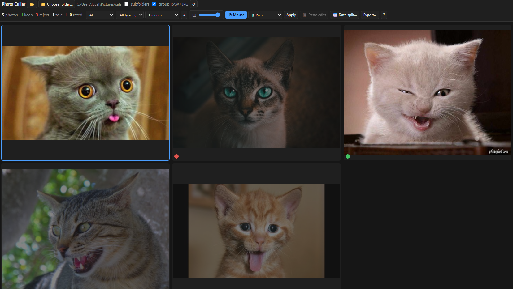
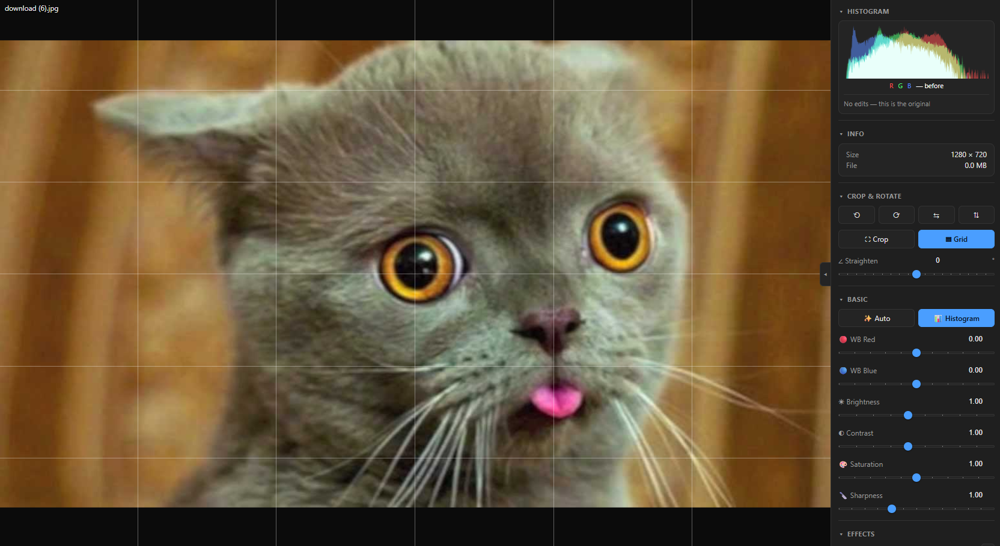
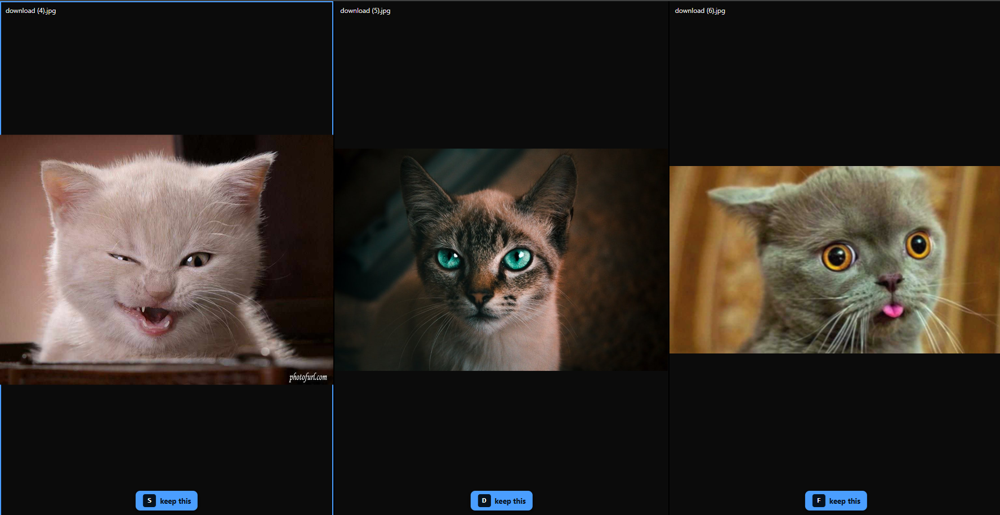

# Photo Culler

A local web app for culling photo shoots. It scans a folder, caches thumbnails
and previews, and puts every keep/reject/rate decision on a key under the left
hand so you can work through a folder without leaving the keyboard.

The backend is Python (FastAPI) and the UI is plain JavaScript in the browser.
It binds to localhost, and nothing is uploaded anywhere.

Marks live in a SQLite database keyed by file path. Nothing on disk is written
or moved until you export.

## Screenshots

<!--
Drop image files in docs/screenshots/ and they'll show up below.
Suggested shots: the grid view, loupe/full view, and compare mode.
-->

| Grid | Loupe | Compare |
| --- | --- | --- |
|  |  |  |

## Install

Python 3.8 or newer.

```bash
pip install -r requirements.txt
python app.py
```

The app starts at <http://127.0.0.1:8000> and opens a browser tab. Pass
`--no-browser` to skip that, or `--port 8080` to move it; if the port is taken
the next free one is used and the real URL is printed. Click **Choose
folder...** in the top bar to pick a folder with your OS dialog, and **↻** to
rescan the current one.

RAW support comes from `rawpy` and HEIC from `pillow-heif`. Both are in
`requirements.txt`, but if no wheel exists for your platform the app still runs
and skips those formats.

## What it reads

JPEG, PNG, WebP, TIFF, GIF, BMP, camera RAW (CR2/CR3, NEF, ARW, RAF, RW2, DNG,
ORF and others) and HEIC/HEIF. Subfolders are optional. RAW decoding uses the
embedded preview, which is why a 2000-photo RAW folder opens in seconds instead
of minutes; the preview is turned the way the RAW's own header says, so
portrait RAWs come up upright. Capture times, camera and lens are read from
RAW files too (from their TIFF container or their embedded preview).

A RAW and a JPEG with the same base name collapse into one grid item tagged
`JPG+RAW`. Marking, comparing, exporting and deleting then act on both files, so
the pair never drifts apart. Turn it off with the **group RAW+JPG** checkbox.

## Culling

The grid lazy-loads cached thumbnails, and a background thread renders the rest
ahead of you in the order the grid shows them. Thumbnails you fling past before
they arrive are cancelled, so the ones on screen are never stuck behind them.
JPEGs are decoded straight at reduced size, so a 24MP thumbnail costs a tenth
of a full decode. The size slider is remembered between sessions. Sort by filename, date taken, date modified, size or rating, newest
first by default. Filter down to keepers, rejects, unflagged or rated photos.
The header counts how many photos are still unflagged ("N to cull").

Flags are keep/reject and ratings are 0 to 5 stars. Both are stored in SQLite,
so reopening the folder brings your marks back. `U` reverts the last flag or
rating, including a full compare verdict in one press.

Compare puts up to 3 images side by side with synchronized zoom and pan: zoom
one and all of them zoom. `S`, `D` or `F` keeps that frame and rejects the
others. Select more than 3 and compare turns into a left-versus-right
tournament (`←`/`S` against `→`/`F`) that runs until one frame is left, keeps
it, rejects the rest and closes.

## Editing

Loupe view has scroll-to-zoom, drag-to-pan, and a docked edit sidebar. `Tab`
hides the whole panel; every section collapses on its own.

**Crop & Rotate** — rotate in 90° steps, flip, straighten by a fine angle (with
auto-crop to the largest inscribed rectangle), and crop (`C`, then drag a box).
The crop drag can be constrained to an aspect ratio: free, the original ratio,
1:1, 3:2, 2:3, 4:3, 3:4, 4:5, 5:4, 16:9 or 9:16.

**Lens** — barrel/pincushion distortion, lateral chromatic aberration, and
vertical/horizontal keystone. All three run on the full frame before anything
crops it, and all three keep the frame filled, so correcting a wide lens never
leaves black wedges to trim off.

**Light** — exposure in stops, contrast, highlights, shadows, whites, blacks,
brightness, and one-press auto-levels.

**Color** — independent red and blue white-balance gains, vibrance (weighted by
how unsaturated a pixel already is, so skin barely moves), saturation, and a
black & white conversion.

**Detail** — clarity (local contrast, negative for a soft look), sharpness, and
noise reduction.

**Retouch** (`P`) — a healing brush. A ring under the cursor shows the brush at
the size the next stroke will use. **Brush** paints over whatever you drag
across; **Spot** fixes one blemish per click and lets you drag out the source
yourself. Either way the app picks where to source from: it scores candidate
areas around what you painted, rejects any that overlap the region itself, and
prefers calm ones over busy ones — so a stroke along a power line is not healed
with more power line.

The whole painted region is sourced by one translation rather than dab by dab,
which keeps the texture lined up across a stroke instead of producing a
patchwork. **Heal** then blends it in the gradient domain — the region inherits
the surrounding colour *and* shading, so a patch dropped on a gradient does not
show its edge — while **Clone** copies pixels as they are.

Click a painted region to remove it. Zoom in first if you like: strokes land
where you paint at any zoom, and the middle mouse button pans while you work.
Brushing off the edge of the picture is fine — only the part that lands on the
image is used.

**Effects** — vignette (positive darkens the corners, negative corrects lens
falloff), film grain, and a solid border with width and color.

Every slider has tick marks, a type-in numeric field, and resets on
double-click. Tone and colour sliders (exposure, highlights, shadows, whites,
blacks, contrast, brightness, white balance, saturation, sharpness) preview
exactly as you drag: the server renders the picture once without them, and the
browser applies the very lookup tables and blends the server will bake,
computed from the same formulas and the picture's own histogram. The other
sliders — and all of them once vibrance, clarity, noise reduction, vignette or
grain are on — stream server drafts at the pane's size while you drag, one in
flight at a time.

What the loupe, the grid and the export show is the same pipeline. Previews and
thumbnails are rendered from a base decoded no bigger than they need (bigger
for a heavy crop, so it still shows full detail), and the filters that work in
pixels — grain, sharpening, noise reduction — are sized relative to the frame,
so a preview is the full-size export, downsized. The lens corrections,
keystone, straighten and crop are one resampling, not four.

The **Histogram** panel overlays the original's tone curve in white and lists
every active adjustment. Each line in that list is a switch: click it to park
that one adjustment and click again to bring it back with its value intact —
an A/B for a single change without touching the rest of the stack.

Edits are stored per photo in the database as an undo/redo history
(`Ctrl+Z` / `Ctrl+Y`), and the grid shows an edited photo with a live preview
and a ✎ badge. `Ctrl+C` / `Ctrl+V` copies the whole edit stack onto another
photo, and presets save a stack by name. `O` flips between original and edited,
`I` opens an EXIF panel, `G` toggles the alignment grid.

A RAW+JPEG pair is one photo in the UI, and the edit stack is mirrored onto
both members — the RAW's own preview shows the changes, exporting it renders
them, and turning grouping off doesn't reveal an unedited twin.

For a photo with a negative behind it, the Info section offers a **JPEG / RAW**
switch that picks which file the loupe renders. It matters because the camera
JPEG carries the camera's film simulation and tone curve while an export
rendered from the negative goes through libraw, and the two do not look alike.
Ticking "JPEG rendered from the RAW" in the export dialog flips the loupe to RAW
for you, so what you are editing is what will be written.

In RAW view the whole editor works off the negative: every adjustment renders on
top of it, toggling original ⇄ edited stays on it, navigating to the next photo
stays on it, **Save copy** bakes from it, and the Info panel reports the RAW's
own dimensions and file size instead of the JPEG's. The switch is remembered
between sessions.

The first RAW preview is a half-size demosaic (a fraction of a second; the
export does the full one) and shows a spinner while it runs; it is cached to
disk, so every edit after that is immediate and re-opening the photo is
instant. Compare, the tournament and the grid follow the same switch, so a
photo looks the same wherever it is drawn.

The file on disk is never rewritten, so **Reset** always gets you back to the
original. Exporting bakes the edits into the output file, keeping the EXIF and
the colour profile. **Save copy** writes
the edited version next to the original as `<name>_edited.jpg` and adds it to
the library.

Rotating, flipping or straightening drops the crop, because the crop box is
expressed in the rotated frame. Those, and any lens correction, also clear the
retouch spots and say so: the spots sit on the finished frame, and moving the
picture under them would heal the wrong pixels. Re-cropping is the exception —
brush strokes and spots are remapped into the new frame instead. Switching a
geometry change off in the histogram list parks the crop and strokes that sit
on it, and switching it back on brings them back.

## Getting photos back out

**Export** copies or moves kept, rejected or rated photos into a folder,
defaulting to `<photo folder>/cull_output`, optionally keeping the subfolder
structure. Edited photos are exported as JPEG with the crop, rotation and tone
applied, EXIF and colour profile included; everything else is copied byte for
byte. Optionally re-encode JPEGs at a chosen quality on the way out, EXIF
included. Photos are exported by a few workers in parallel.

When the library holds RAW files, the export dialog adds three switches, and
they are independent — tick any combination:

- **JPEG rendered from the RAW** — a full demosaic of the negative with the
  edits baked in, rather than the embedded camera preview the UI browses. If
  the RAW has a JPEG sibling in the same export, this one is named
  `<name>_raw.jpg` so the two don't collide.
- **The RAW file itself** — copied (or moved) alongside.
- **An .xmp sidecar** — written beside the copied RAW. A RAW can't carry baked
  pixels, so "the RAW with my changes" means the negative plus a record of
  them: the rating and keep/reject label go in standard XMP where other
  software reads them, and the edit stack goes in a `culler:` namespace.

With no switches touched the behaviour is the old one: a RAW is copied, and a
RAW carrying edits also renders a baked JPEG. A move that would destroy an
un-copied edited RAW is still refused and reported instead.

Moving updates the marks to the new paths and rescans the folder, so nothing is
lost.

**Date split** moves or copies photos into subfolders named by date taken or
date modified, either inside the current folder or somewhere you pick. A
RAW+JPEG pair always lands in one folder, dated by whichever member knows when
it was taken.

With **subfolders** unticked, export, date split and delete act only on the
photos the grid shows, not on subfolder photos from an earlier scan.

**Delete rejected** opens a review grid of every rejected shot. Click a photo to
spare it, then delete only what is still highlighted. Deletion goes to the
Recycle Bin through `send2trash`; if that package is missing the delete is
permanent.

## Keyboard shortcuts

The shortcuts sit around the **ESDF** nav cluster with the index finger on `F`,
so the whole cull runs under the left hand and the right one stays on the mouse.

| Key | Action |
| --- | --- |
| `E` `S` `D` `F` (or arrows) | Move selection (up / left / down / right) |
| `Home` / `End` | First / last photo |
| `G` / `Enter` | Open loupe (full) view |
| `Esc` | Back / close |
| `W` | Flag **Keep** (auto-advances) |
| `R` | Flag **Reject** (auto-advances) |
| `Q` | Clear flag |
| `1`-`5` | Star rating, `` ` `` = 0 stars |
| `U` | Undo last mark (flag/rating) |
| `P` | Retouch mode (loupe) |
| `Ctrl`+`Z` / `Ctrl`+`Y` | Undo / redo edits (loupe) |
| `Ctrl`+`C` / `Ctrl`+`V` | Copy / paste edits between photos (loupe) |
| `I` | EXIF info panel (loupe) |
| `Space` | Add/remove current photo from the compare set (auto-advances) |
| `C` | Open compare (the compare set, or current + next if none) |
| `S` `D` `F` | In compare (3 or fewer): keep that image, reject the others, close |
| `X` | Clear compare set |
| `T` | Cycle filter |
| `B` | Toggle **mouse mode** |
| `V` / `?` | Show shortcuts |

In loupe and compare, scroll (or `E`/`D`) zooms, dragging pans and stays synced
across compare panes, `S`/`F` moves to the previous or next photo in loupe and
focuses a pane in compare, and `Z` or a double-click resets the zoom. Marking
keys keep working, and so does the edit bar: crop (`C`), retouch (`P`) and
every slider act on whichever photo is current. In retouch mode the left button
paints, so pan with the middle button.

**Mouse mode** (`B`) semi-selects whatever photo you hover, shown with a dashed
outline, and every hotkey acts on that instead of the keyboard cursor. Hover,
press a flag or a rating, move on. There is no auto-advance here, since the
mouse is doing the navigating.

## Where things are stored

- Marks, edits and the last-opened folder: `~/.photo_culler/culler.db`, or
  `$PHOTO_CULLER_HOME` if that variable is set.
- Rendered thumbnails and previews: `~/.photo_culler/cache/`. Safe to delete at
  any time; it regenerates. Pruned back to 2 GB, oldest renders first, at
  startup and periodically while the app is running — a long editing session
  adds a render per slider release and a decode per RAW previewed.
- Rescanning a folder drops database rows for files that no longer exist, so
  marks for deleted photos do not accumulate.

## Development

```bash
python test_edits.py   # the edit pipeline (rotate/crop/tone/border maths)
python test_api.py     # the HTTP API end to end, on a throwaway library
```

`test_api.py` boots the real app on port 8123 with `PHOTO_CULLER_HOME` pointed
at a temp directory, so it cannot touch your own database or cache. Set that
variable yourself if you want a scratch library:

```bash
PHOTO_CULLER_HOME=/tmp/culler-scratch python app.py
```

## Known limitations

- In RAW view the grid demosaics every RAW it shows (a fraction of a second
  each, cached), so a RAW-only folder fills more slowly than in JPEG view.
- While a tone slider moves, its preview is drawn over a JPEG of the picture
  without it, so the pixels can differ by a level or two from the render that
  replaces it on release — it is the same picture, a few JPEG artefacts apart.
- An export with every filter on costs about 3 seconds per 24MP photo (spread
  over a few workers); noise reduction and sharpening are the costly ones.
- The server binds to 127.0.0.1, refuses requests for any other host name and
  cross-site writes, and has no authentication — fine for a local tool, not
  fine on a shared machine.
